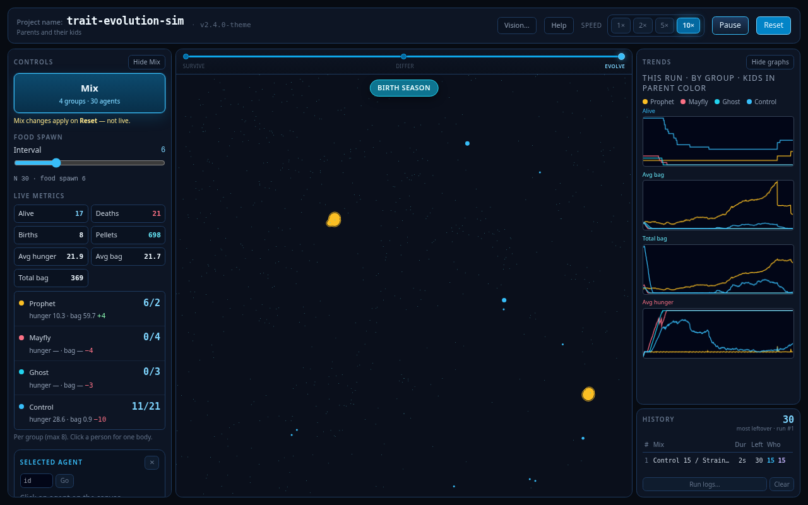

# trait-evolution-sim

A 2D island where simple people eat, survive, and have kids. You mix their traits and watch which kinds win.

## Play it

There is no hosted demo. Download or clone the repo so `index.html` and the two freeze files sit in the same folder, then open `index.html` in a browser. There is no build step. Opening a single file from GitHub only shows the source.

## What to watch for

- One color camping on the food while another starves.
- A parent with kids nearby, still walking the same patch.
- A mix that looked even at Reset, then one kind quietly takes the map.

## How to play (Evolve)

1. Open **Mix**.
2. Pick a story (Groups, Families, or Rungs), or edit the groups yourself.
3. Press **Apply**. The island does not change yet.
4. Press **Reset**. That is when the mix spawns.
5. Watch the island. Click a person for their traits and bag. Trends and History sit on the right. Food interval and Pause / Speed are live. The in-app Help has the full rules.

## Three games, three questions

Each file is its own game. Keep them in the same folder if you want all three.

- **Survive** lives in [`phase-0-survive-finished.html`](phase-0-survive-finished.html). If everyone is the same body, how many live?
- **Differ** lives in [`phase-1-differ-finished.html`](phase-1-differ-finished.html). If they are not the same at spawn, who is left?
- **Evolve** is the live game in [`index.html`](index.html). Adults stay. Do their kids look like them?

## What we learned

In Differ we kept four body traits by changing one knob at a time on a uniform crowd and asking how many were still standing:

| Trait | Why it stayed |
|-------|----------------|
| Hunger rate | Changes how many live, smoothly. |
| Efficiency | Same. How much a bite from the bag helps. Very low wipes the crowd. |
| Hunt | Seeking food was basically on or off. Zero is off. |
| Speed | Barely changed how many lived. Kept so a mix can look slow vs twitchy. |

Meal size and “how hungry before I nibble” did not change survival. Food interval and headcount are weather, not a body. Evolve adds birth frequency so parents can have kids.

Do not rank a mix by average bag. One fat leftover on a pile of food makes that number look huge while the rest of the crowd is already gone. Judge who is still walking.

## Status

Live release: `2.4.0-theme`. This project is complete. Evolve was the last game. The economy and trade ideas were never built here.

## How it's built

One person, Tiago, is the product owner. An AI pair helps type. The live game is one HTML file. Versions are named `N.x.y-codename`. Work ships one small step at a time. When a phase feels finished, that game is frozen in its own file and live `index.html` becomes the next one. Agent rules live in [`AGENTS.md`](AGENTS.md).

## Repo map

| Path | What it is |
|------|------------|
| `index.html` | Live Evolve. The only file that grew. |
| `phase-0-survive-finished.html` | Frozen Survive. Play it; do not patch it. |
| `phase-1-differ-finished.html` | Frozen Differ. Play it; do not patch it. |
| `phase-1-differ-presets/` | Extra Mix Import JSON. |
| `VERSION` | Live label. Must match the header badge. |
| `AGENTS.md` | How any AI should behave here. |
| `FUTURE_FEATURES.md` | Archived ideas. No open work. |
| `IMPLEMENTATION_LOG.md` | What each version shipped. |
| `archive/` | Old snapshots. Index: `archive/MANIFEST.md`. |
| `design-docs/` | Design notes. Not the live app. |
